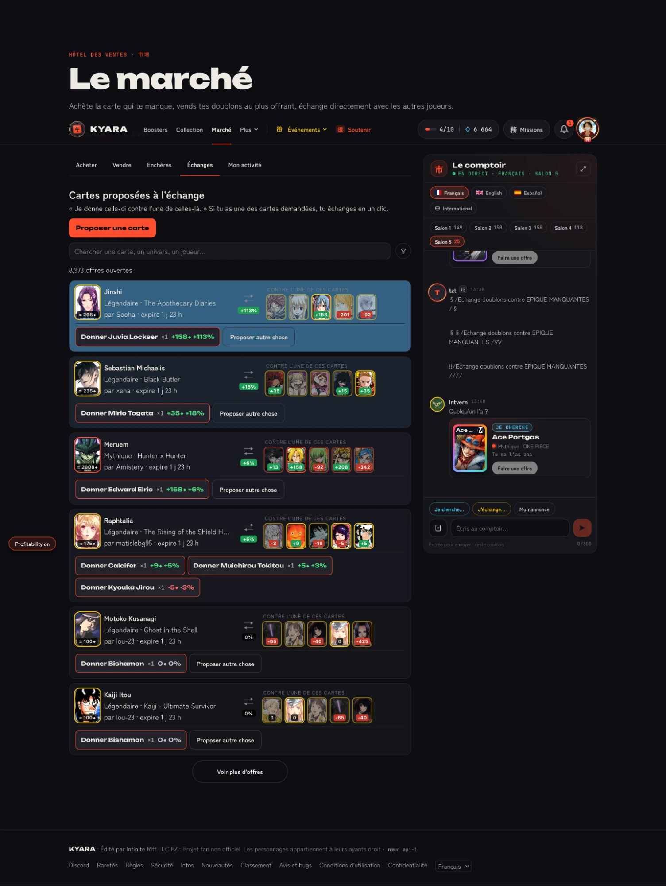

# Kyara Extension

Firefox extension for [kyara.games](https://kyara.games): in the **Marché → Échanges** (Market → Trades) tab, it shows card values and the profitability of each offer, and lets you filter and sort offers. On the booster page, it can open only your free boosters.

HTML version of this page: [`docs/index.html`](docs/index.html). Version history: [CHANGELOG.md](CHANGELOG.md).



## Features

### Trades tab

- Badge on each card: `≈ G◆` on the offered card, `G − W` on the wanted cards (plus the gain in % on hover).
- Under the ⇄ arrow: the best gain in % you can get from the offer.
- "Donner" (give) buttons: compact, labelled with the gain (`+9◆ +5 %`, green or red) and sorted from most to least profitable.
- Only cards you can actually give count (owned and not locked: the ones with a "Donner" button).
- Offer background tinted from blue (gain) to red (loss), based on the best relative gain among those cards. The color reaches full intensity at ±100 % by default (adjustable from 10 to 200 % in the filter panel). "Profitability on/off" pill at the bottom left.
- Ring around cards in their rarity's official color (read from the card's color, or from its "Rare · …" text).
- Hovering a card: current minimum price on the market.
- Small spinner at the bottom right while prices are loading.

### Filter panel

A funnel icon button, right of the search field, opens a popover with two sections.

- *Kyara filters*: the site's pills (Que je n'ai pas, Que je peux accepter…), mirrored as is and grouped into categories.
- *Extension filters*:
  - **Profitability**: Off / Neutral and up / Positive, plus a minimum gain slider (1 % steps);
  - **Rarity**: one or more rarities of the offered card (none checked = all);
  - **Wanted cards**: a list of card names (case and accents ignored). Offers proposing one of them are highlighted, and a toggle can hide all the others;
  - **Sort**: offers ranked from most to least profitable;
  - **Offer colors**: gain at which the tint reaches full intensity.

Filtered or sorted offers never show before being processed (no flicker). When a filter is on, "Voir plus d'offres" (load more) keeps loading until 10 offers are visible at page load, and 10 new visible offers after each click (at most 25 loads in a row, waiting for prices between loads). The button shows a loading text meanwhile, and "No other offer matches the filters" shows when a load brings nothing.

### Keyboard shortcuts

| Key | Action |
|---|---|
| `F` | Open or close the filter panel |
| `P` | Turn profitability colors on or off |

Shortcuts are ignored while typing in a text field, or with Ctrl, Alt or Cmd held.

### Booster page

- A "×N" option in the booster count picker opens exactly your free boosters, without spending chakra. The site's chakra warning is skipped while this option is chosen.
- If the site changes its opening request, the extension cancels the opening instead of sending it as is: nothing is spent.

### General

- Unknown values show nothing (never a `?`).
- Texts in French and English, depending on the browser language.

This is not a bot: the extension never acts on your behalf. It reads the responses the site already loads, and only makes a few grouped requests (`/api/fair-play/prices`, max 200 ids) limited to visible offers you can accept (paused 5 min after a failed response), plus one request per hovered card.

Stack: [WXT](https://wxt.dev) + TypeScript. Project rules: [CLAUDE.md](CLAUDE.md).

Displayed texts live in [`src/locales/en.json`](src/locales/en.json) and [`src/locales/fr.json`](src/locales/fr.json): no visible text is written in the code.

## Development

```bash
pnpm install
```

```bash
pnpm dev
```

`pnpm dev` opens Firefox on the Trades tab with the extension, and reloads it on every change. Firefox uses a separate profile, kept in `.firefox-profile/` (not versioned): log in to kyara.games only once. `[kyara-extension:…]` logs show in the page console (F12) and in `about:debugging` → Inspect for the background script.

```bash
pnpm build:debug
```

Non-minified build with logs, in `.output/firefox-mv2-dev/`.

## Installation (production build)

```bash
pnpm build
```

1. Open `about:debugging#/runtime/this-firefox`.
2. "Load Temporary Add-on…" → pick `.output/firefox-mv2/manifest.json`.
3. Private browsing: `about:addons` → Kyara Extension → "Run in Private Windows" → Allow.

The production build contains no logs.

## Release

```bash
pnpm release
```

Run from an up-to-date `main`, after bumping `"version"` in `package.json` and adding its entry to [CHANGELOG.md](CHANGELOG.md) (and [`docs/changelog.html`](docs/changelog.html)). The script checks the code, submits the version to addons.mozilla.org with its sources and [`amo-metadata.json`](amo-metadata.json) (AMO keys in `.env`, see [`scripts/release.sh`](scripts/release.sh)), then creates a GitHub release (tag + changelog). Once Mozilla approves the version, it is published on the store and installed copies update themselves.

## Chrome (partial)

```bash
pnpm build:chrome
```

Chrome build (Manifest V3) in `.output/chrome-mv3/`, to load through `chrome://extensions` → Developer mode → "Load unpacked". The passive price cache only exists on Firefox: on Chrome, prices only come from the fair-play requests, so fewer badges. Firefox stays the reference target.

## Tests and checks

```bash
pnpm test
```

```bash
pnpm test:coverage
```

```bash
pnpm check
```

## Documentation

Every Markdown file meant for humans has an HTML twin in [`docs/`](docs/), sharing [`docs/style.css`](docs/style.css) and [`docs/script.js`](docs/script.js):

| Markdown | HTML |
|---|---|
| [README.md](README.md) | [docs/index.html](docs/index.html) |
| [CHANGELOG.md](CHANGELOG.md) | [docs/changelog.html](docs/changelog.html) |

Open the HTML files directly in a browser: no build needed.
